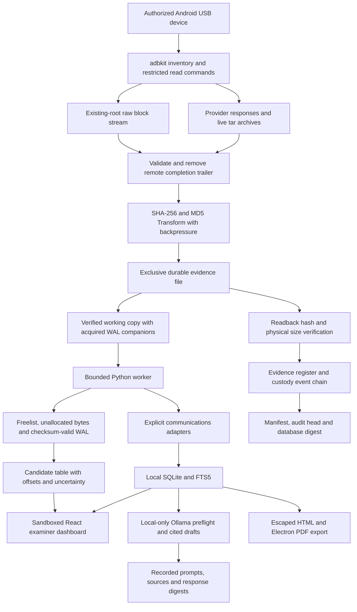

# OpenForensic architecture

The examiner machine owns acquisition, storage, parsing, and inference. The renderer has no Node integration, filesystem access, shell execution, or arbitrary IPC. The preload exposes fixed methods, each checked by the main process against a runtime schema and the originating top-level window.

## Device boundary

Only fixed reads and tightly validated block commands can pass the command policy. There is no arbitrary shell channel, device push, install, delete, settings change, `adb root`, exploit, or encryption bypass. A randomized completion trailer carries remote exit status through `exec-out`; its bytes never enter the evidence payload. Existing root is detected as either a root shell or `su`.

The policy prevents application-issued target writes. It does not stop live Android services or acquisition-triggered logs. Logical app archives can contain inconsistent database/WAL snapshots because a running application can write during capture. These facts are recorded and surfaced.

## Evidence and case boundary

Acquisition writes originals using exclusive creation, durable file handles, stream hashes, and disk readback checks. Interrupted sources retain partial bytes and their disk hashes. The manifest records complete/partial status. An evidence hash is never substituted for proof of identity or provenance.

The SQLite case database stores original-item references, normalized messages, carved candidates, auxiliary artifacts, parser runs, AI runs, and derivative hashes. All SQL inputs from the renderer are bounded and parameterized. FTS queries quote user tokens. Original evidence and analysis derivatives have separate paths and integrity registers.

Audit events use deterministic JSON serialization and a SHA-256 previous-event chain. The application verifies the chain before every append and flushes writes. Sealing freezes mutations, checkpoints SQLite, and creates a manifest containing a database digest and audit head. Host administrators can replace local files; independent preservation of the seal is required to make tampering externally detectable.

## Parser boundary

The Python subprocess receives only a verified working copy. Archive extraction rejects absolute/parent paths, links, device entries, duplicate output files, and oversized members. Output rows, total bytes, file counts, candidate counts, and runtime are bounded. Typed JSONL is ingested transactionally; unknown or malformed output rolls back ingestion. Original and derivative hashes are retained.

Live adapters make explicit assumptions about supported schemas and timestamp units. Protobuf wire decoding supplies numbered fields only. SQLite carving supplies candidates only; it never silently maps heuristic bytes into verified message text, participants, timestamps, or deletion events. WAL frames must pass salt and rolling-checksum validation; commitment is determined by a valid subsequent commit marker.

## AI and report boundary

The main process retrieves a bounded set of source rows, checks Ollama's local-only status and model metadata, and calls a loopback endpoint with redirects disabled. No model tools are supplied. Evidence text is treated as untrusted prompt data. The application rejects missing or out-of-scope citations, retains the full prompt/response and source snapshot digest, and labels drafts for examiner review. Valid IDs do not guarantee valid statements.

Reports escape all evidence and AI text. Exported HTML has a restrictive CSP; PDF rendering uses a hidden sandboxed Electron window. Media uses per-case capability URLs, restricted extensions, verified derivative hashes, and resolved path containment. Device sanitization is backlog work in a separate destructive workflow and cannot enter this acquisition allowlist.
