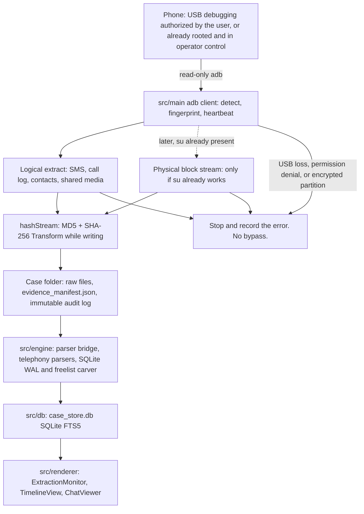

# OpenForensic architecture

OpenForensic is a local examiner app for authorized Android acquisition. It runs on the examiner's machine, talks to the phone only over a user-authorized adb session (or an already-rooted phone the operator controls), and keeps case evidence on that machine.

## Boundaries

- Acquisition only after the phone user has authorized USB debugging, or the phone is already rooted and in the operator's control.
- No exploit root, no lock-screen or file-based encryption bypass, and no covert implant.
- Deleted data means SQLite freelist and WAL records, plus unallocated carving only on an image already acquired under that model. A full dump of every deleted byte from a locked encrypted phone is out of scope.
- The examiner machine keeps SQLite FTS5 in `case_store.db`. The web viewer and review also read MongoDB Atlas database OpenForensic when `MONGODB_URI` is set.

## Stack

| Layer | Choice |
| --- | --- |
| Shell | Electron |
| UI | React, Tailwind |
| Bundler | Vite |
| Device I/O | Node `adbkit` plus `child_process` streams |
| Hashes | Node `crypto` Transform (MD5 and SHA-256) while bytes are written to disk |
| Parsers | Python 3 |
| Case database | Local SQLite FTS5 (`case_store.db`) |

## Pipeline

Extraction, parsing, and UI stay separate. The phone path is read-only. Hashes are computed on the write stream. The audit log is append-only JSON.



## Directory map

This is the planned tree. It is not a second task list. `physical.ts` and the carver are later work; they sit in the tree so the v1 scaffold has a place to grow.

```text
.cursorrules
TODO.md
ARCHITECTURE.md
package.json
src/main
  index.ts
  adb/client.ts
  logical.ts
  physical.ts
  integrity/hashStream.ts
  manifest.ts
src/engine
  parser_bridge.ts
  carver_sqlite.py
  parse_telephony.py
  schemas.py
src/db
  index.ts
  schema.sql
  queries.ts
src/renderer
  App.tsx
  ExtractionMonitor
  TimelineView
  ChatViewer
  caseStore
```

## Chain of custody

- The adb client does not write to the phone. Content queries and file pulls are reads.
- `integrity/hashStream.ts` hashes each byte stream with MD5 and SHA-256 in a Transform as the file is written. Hashes are stored in `evidence_manifest.json`, not computed from a second read after the fact.
- `evidence_manifest.json` records device ids, timestamps, operator, source paths, and hashes.
- The audit log is immutable JSON: each event is appended. The UI does not rewrite earlier lines.
- Case folders support create, open, and archive. Archive does not delete the manifest or the log. The case screen already archives the open folder.
- The timeline filters by US Eastern date, sender, and platform (SMS, call, or media).
- The custody tab can print, and it can save a standalone HTML file the examiner can open outside the app. Times in that file are US Eastern.

## Modules

- `src/main` owns the Electron process, adb, logical extract, the later physical stream, hashing, and the manifest.
- `src/engine` owns parsing. Node calls Python through `parser_bridge.ts`. Parsers for telephony, WhatsApp, and Messenger run only when that database and its key are already in the acquisition. There is no crypt breaker.
- `src/db` owns `case_store.db`. Normalized message rows use `timestamp_utc`, `platform`, `sender_id`, `receiver_id`, `message_text`, `media_path`, and `is_deleted_flag`, with an FTS5 index for search.
- `src/renderer` owns the live extraction monitor, the timeline, and the chat thread viewer. It reads the case store. It does not talk to adb.

## Failure handling

USB disconnect, permission denial, and encrypted partitions stop the operation and append an error to the audit log.

- Heartbeat: if the USB device disappears, extraction stops and the partial files already hashed stay in the case folder with the error recorded.
- Permission denial: if an adb content query or pull is rejected, that source is marked failed. The app does not retry through another privilege path.
- Encrypted partition: if a read hits file-based encryption or another locked volume, the stream stops. The error is recorded. There is no lock-screen bypass and no encryption bypass.

## v1 layout

The running tree is the plan above, plus a web viewer and a confirmed free-space wipe.

```text
src/main          Electron main and preload
src/engine        adb, logical extract, hash stream, manifest, audit, free-space wipe
src/db            case_store.db SQLite FTS5
src/renderer      case create/open, monitor, timeline, chat, review
src/engine/physical.ts   refuses block imaging
web/              Vite viewer, Netlify functions /api/cases and /api/ai
shared/           sample case and the local reviewer
```

The desktop app binds cases under the Electron user-data directory. The web dev server listens on `0.0.0.0:41773`. Review in the deployed viewer uses the Netlify AI Gateway model `gpt-4o-mini`. Local dev uses the labeled fallback when that gateway is unreachable. Atlas is database `OpenForensic` on the project and cluster of the same name. `MONGODB_URI` is host environment only.

Free-space wipe is not part of extraction. After the operator types WIPE, the desktop app reads `df -k /sdcard` and writes junk files to `/sdcard/OpenForensic/free-space-wipe` until about 128 MB remains. It does not write block devices, does not unlock the phone, and stops on USB loss, permission denial, or encrypted storage. Remove wipe files deletes only that directory.

## Deployment

USB acquisition cannot run on Netlify. The examiner machine is the only place adb, the case folder, and `case_store.db` exist.

The Netlify site is the web case viewer. It reads the Harbor Street sample without a phone, and it reads Atlas when `MONGODB_URI` is set on the host. The connection string is not committed.

The local case folder remains the hashed copy. Atlas is an additional store for the viewer and review, database name OpenForensic.
